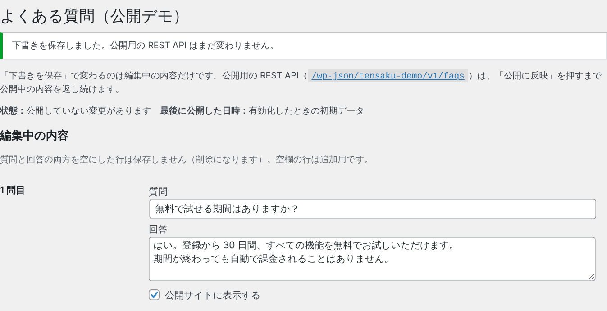
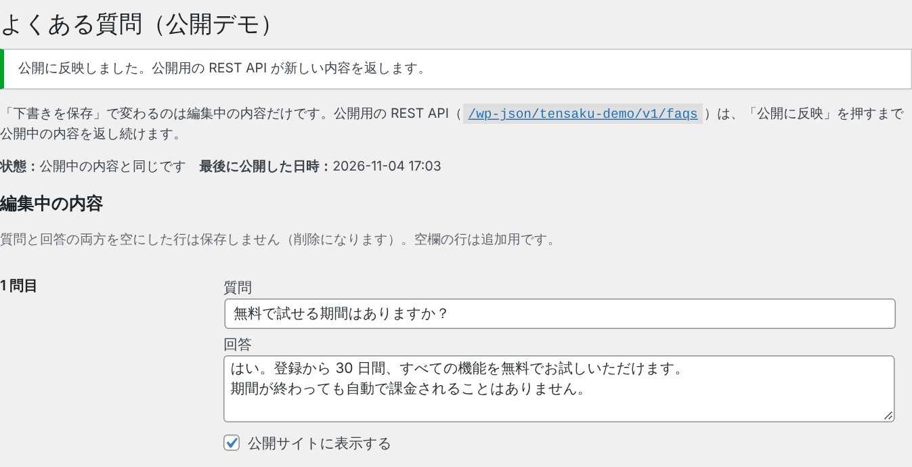
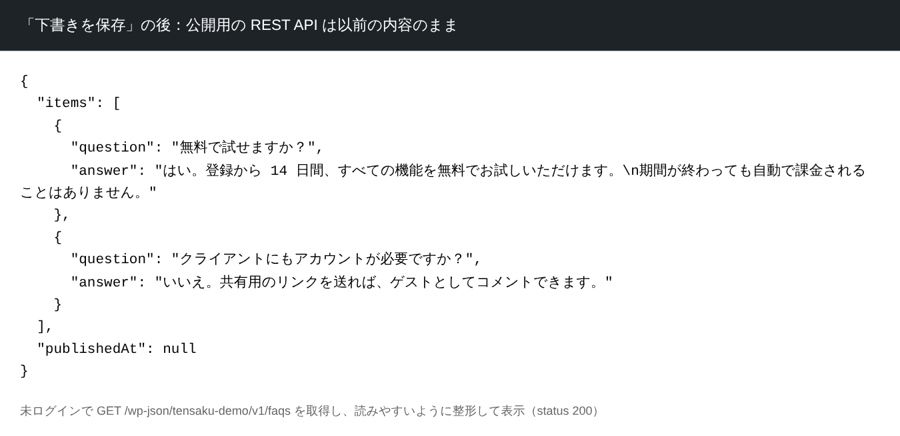
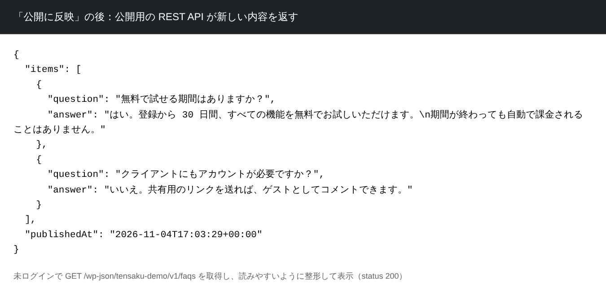
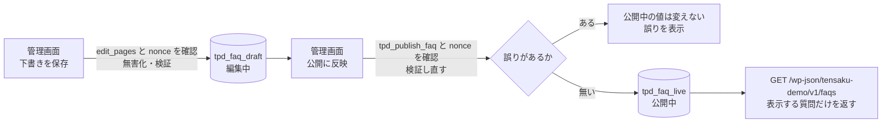

# tensaku-wp-publish-example

ヘッドレス WordPress で、**管理画面で保存した内容を、明示的に「公開に反映」するまで公開用の REST API に出さない**公開フローのサンプルです（PHP の WordPress プラグイン）。

自主制作サイトで扱った公開フローの考え方をもとに、公開用に新しく書いた小さなプラグインです。元サイトのプラグイン・共通の開発基盤・デプロイの仕組みは含みません（詳しくは「[元の実装との関係](#元の実装との関係)」）。

- 元の公開サイト（架空のデザインレビューツール「TENSAKU」のサービスサイト）: https://tensaku.preview-dev.website/

> 同梱のデータ（よくある質問 3 件）はすべて架空です。外部への送信・通知・ビルドやデプロイの起動は行いません。

## 試し方（3 分）

1. 「[Playground で開く](https://playground.wordpress.net/?blueprint-url=https://raw.githubusercontent.com/tzk-s/tensaku-wp-publish-example/main/playground/blueprint.json)」から、ブラウザー上の一時的な WordPress を起動します（管理者として自動でログインし、管理画面「よくある質問（公開デモ）」が開きます）。
2. 画面の中の `/wp-json/tensaku-demo/v1/faqs` のリンクを開き、公開用の REST API の応答を見ておきます。
3. 管理画面に戻り、1 問目の質問や回答を書き換えて「**下書きを保存**」を押します。状態が「公開していない変更があります」になります。
4. REST API の応答を再読み込みします。**まだ変わりません**（公開中の内容を返し続けます）。
5. 「**公開に反映**」を押してから REST API を再読み込みすると、**新しい内容に変わります**。

| 「下書きを保存」の後 | 「公開に反映」の後 |
| --- | --- |
|  |  |
|  |  |

画像はローカルの一時環境（下記「ローカルでの起動とテスト」）で撮影したものです。REST API の画像は、日本語を読みやすくするため、取得した JSON を整形して表示しています。

> Playground のリンクは、このリポジトリの `main` ブランチにあるプラグインを読み込みます。Playground の WordPress は閉じると消え、ここで行った変更はどこにも残りません。

## このサンプルで見てほしいこと

- **編集中と公開中を別の値として持つ。** `wp_options` に `tpd_faq_draft`（編集中）と `tpd_faq_live`（公開中）を持ちます。「下書きを保存」は編集中だけを、「公開に反映」は公開中だけを書き換えます。
- **公開用の REST API は公開中の値だけを読む。** `GET /wp-json/tensaku-demo/v1/faqs` は認証なしで読めるので、`tpd_faq_live` から「公開サイトに表示する」質問の `question` と `answer` だけを組み立てて返します（`visible` などの管理用の項目は出しません）。読み取り専用で、書き込みの入口はありません。編集中の値を返す入口は作っていません。どちらの値も `register_setting()` していないので、標準の `/wp/v2/settings` にも出ません。
- **権限と nonce を別々に確かめる。** 保存も公開も、まず `current_user_can()` で権限を、次に `check_admin_referer()` で nonce を確かめます。権限が足りなければ、正しい nonce を持っていても 403 で止めます。
- **無害化・検証・保存・出力を分ける。** 送信値は `tpd_sanitize_faq()` で無害化し、`tpd_validate_faq()` で誤りを判定してから保存します。誤りがあれば保存せず、入力した内容と誤りを画面に表示し直します。出力するときは `esc_html()` / `esc_attr()` などでエスケープします。
- **公開の時点でも検証し直す。** 「公開に反映」でも編集中の内容を同じ規則で検証し、誤りがあれば公開中の値を書き換えません（以前の公開内容がそのまま残ります）。

### 誰が何をできるか

| 役割（WordPress の標準） | 管理画面を開く・下書きを保存 | 公開に反映 |
| --- | --- | --- |
| 管理者 | できる | できる |
| 編集者 | できる | できない（画面にボタンを出さず、送信しても 403） |
| 投稿者・寄稿者・購読者 | できない | できない |

保存には `edit_pages`、公開には独自の権限 `tpd_publish_faq` を使います。`tpd_publish_faq` は、`user_has_cap` フィルターで `manage_options` を持つ人（管理者）にだけ与えます（役割に書き込まないので、プラグインを止めれば権限も消えます）。

**これは承認ワークフローではありません。** 公開の権限を管理者に限っているだけで、別の担当者が承認する仕組み（承認待ちの状態・差し戻し・承認者の記録）はありません。管理者は自分で保存して、そのまま公開できます。

## データの流れ



## ローカルでの起動とテスト

Node.js 24.18.0 以上・npm 11.16.0 以上が必要です（WordPress Playground CLI の動作要件）。

```bash
npm ci                    # WordPress Playground CLI のインストール（package-lock.json どおり）
npm run playground        # 一時的な WordPress を起動（http://127.0.0.1:9400/）
npm run lint:php          # PHP の構文チェック（php コマンドが必要）
```

`npm run playground` では、このリポジトリの `plugin/tensaku-publish-demo` をそのまま読み込み（ファイルを直すと再起動なしで反映されます）、権限の確認用に編集者と購読者も作ります（`playground/blueprint-local.json`）。ログイン画面で `admin` / `password` を入力してください。これは Playground が一時環境に作る管理者の既定値で、この環境を止めると消えます。

公開フローのテストは、起動した WordPress に HTTP で操作して確かめます。

```bash
npm run playground:test   # テスト用の一時環境を起動（別のターミナルで起動したままにする）
npm test                  # 公開フローのテスト（Node.js のテストランナー）
```

テストは状態を順に進めるので、1 回の起動につき 1 回だけ実行します（もう一度実行するときは起動し直してください）。`playground:test` は、テスト専用の mu-plugin（`tests/fixtures/tpd-test-helper.php`）も読み込みます。これは「保存の画面を通らずに不正な値が残っていても公開しない」ことを確かめるためのもので、プラグイン本体には含めていません。

### テストで確かめていること

| 確かめること | 結果 |
| --- | --- |
| 公開用の REST API が表示する質問の `question` / `answer` だけを返し、非表示の質問や `visible` を出さない | 成功 |
| 公開用の REST API に POST の入口が無い（404） | 成功 |
| 管理者が保存すると、編集中の内容だけが変わり、公開用の REST API は変わらない | 成功 |
| 保存しただけの文言が、未認証の公開用 REST API・`/wp-json/`・トップページ・フィードに出ない。標準の `/wp/v2/settings` は未認証では 401、管理者として読んでもこのデモの値を含まない | 成功 |
| 不正な nonce では公開しない（403） | 成功 |
| 編集者は保存できるが、公開のボタンが無く、管理者の nonce を使って送信しても 403 で公開用の値は変わらない | 成功 |
| 購読者は管理画面を開けず、保存も 403 | 成功 |
| 回答が空・質問が 101 文字・表示する質問が 0 件の入力は保存しない | 成功 |
| 編集中の内容が不正なとき、「公開に反映」しても以前の公開値が残る | 成功 |
| 保存して「公開に反映」すると、公開用の REST API が新しい内容と公開日時を返す（タグは取り除き、改行は `\n` にそろえる） | 成功 |

確認した環境: WordPress 6.5.5 ／ PHP 8.3（WordPress Playground CLI 3.1.62、SQLite）／ Node.js 24.22.2 ／ Linux。PHP の構文チェックは PHP 8.3.6 で行いました。

### 確かめていないこと

- MySQL を使う通常の WordPress（レンタルサーバーなど）での動作。確認は Playground（SQLite）だけです。
- WordPress 6.6 以降、PHP 8.1 / 8.2 での動作。
- 「Playground で開く」のリンクからの起動。確認した環境から playground.wordpress.net に接続できなかったためです。代わりに、`playground/blueprint.json` の読み込み先を作業ブランチに変えたものをローカルの CLI で実行し、GitHub からプラグインを取得して有効化し、管理者としてログインした状態で管理画面と公開用の REST API が開けることを確かめました。
- 複数人が同時に保存したときの扱い。後から保存した内容で上書きされます（このデモでは排他制御をしていません）。

## 構成

```
.
├── plugin/tensaku-publish-demo/   # WordPress プラグイン本体（これだけを WordPress に入れる）
│   ├── tensaku-publish-demo.php   # プラグインの宣言・読み込み・有効化の処理
│   ├── includes/
│   │   ├── data.php               # 保存先・架空の初期データ・無害化と検証・公開する形への変換・公開処理
│   │   ├── admin.php              # 管理画面（表示・保存・公開と、権限・nonce の確認）
│   │   └── rest.php               # 公開用の読み取り専用 REST API
│   └── uninstall.php              # 削除したとき、このデモの値を消す
├── playground/
│   ├── blueprint.json             # 「Playground で開く」用（main ブランチのプラグインを読み込む）
│   └── blueprint-local.json       # ローカルの一時環境用（編集者・購読者も作る）
├── tests/
│   ├── publish-flow.test.mjs      # 公開フローのテスト（起動した WordPress に HTTP で操作する）
│   └── fixtures/tpd-test-helper.php # テスト専用の mu-plugin
└── docs/images/                   # README の画像
```

読み始めるなら `includes/data.php` の `tpd_publish()` → `includes/admin.php` の `tpd_handle_save()` / `tpd_handle_publish()` → `includes/rest.php` の順がおすすめです。

## このサンプルに無いもの

公開フローの考え方を見せるための最小構成なので、次のものは含みません。

- 承認ワークフロー（承認待ち・差し戻し・承認者の記録）
- 公開内容の履歴・ロールバック（「公開に反映」すると、以前の公開内容は上書きされます）
- 公開に合わせた静的サイトのビルドやデプロイの起動、通知
- 編集中の内容をフロントエンドで確認するプレビュー

## 元の実装との関係

元サイトでは、ヘッドレス WordPress の設定画面（よくある質問など）で、編集用の値と公開用の値を分けて持ち、管理者の公開操作で公開用の値に写す仕組みを実装しました。編集者は保存でき、公開できるのは管理者だけで、承認ワークフローはありません。

このリポジトリは、その考え方を説明するために**新しく書いた**ものです。元サイトのプラグインのコード・設定画面の構成・データ・接続先・ビルドやデプロイの仕組みは含みません。ファイル構成・関数名・保存先の名前・画面の文言も、このサンプル用に決めたものです。公開の時点で検証し直す処理は、このサンプルで加えたものです。

## 著作権・ライセンス

- Copyright (c) 2026 tzk-s. All rights reserved.
- このリポジトリはポートフォリオとして公開しているもので、オープンソースライセンスは付与していません。コードの再利用・再配布・他の制作物への組み込みは許諾していません（著作権は作者に留保します）。
- 内容を評価するために、clone して手元や WordPress Playground で実行・テストすることは問題ありません。
- なお、GitHub の利用規約により、公開リポジトリは GitHub 上で閲覧・fork できます。
- WordPress Playground CLI は、それぞれのライセンスに従います。このリポジトリには同梱せず、`npm ci` で取得します。
- `docs/images/` の画像は、このプラグインの管理画面（WordPress の管理画面の上に表示）と REST API の応答を撮影したものです。ロゴ・フォントは含みません。
